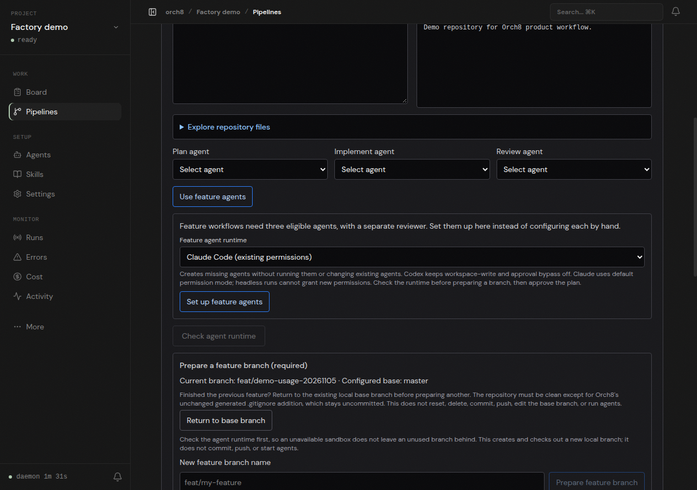
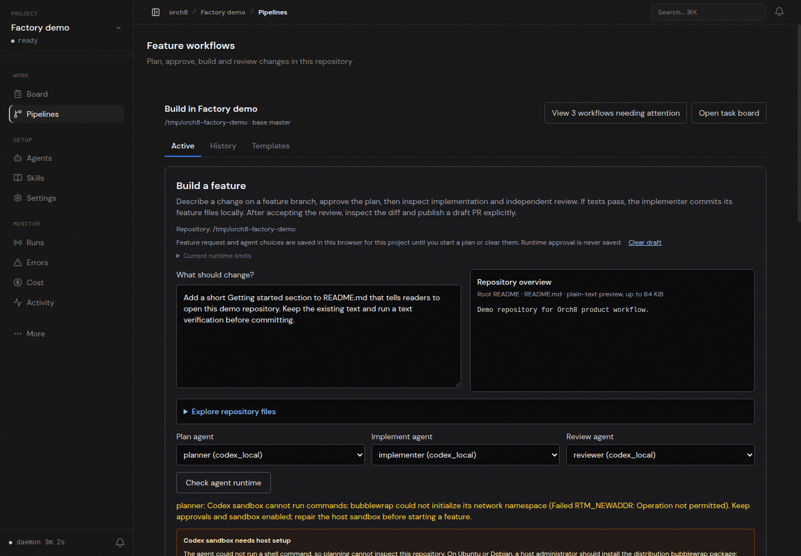

# Orch8

Orch8 is a local software factory. Open a Git repository in the dashboard, describe a feature, review the agent's plan, run implementation and independent review, inspect the real repository changes and test output, then explicitly publish a draft pull request. It runs a local daemon, React dashboard, and CLI agent adapters. The feature workflow supports Codex and Claude Code with their existing permissions; it does not yet isolate each feature in its own worktree.

The repository also contains a broader task board, chat, budgets, and reusable pipelines. Those are not required to start a feature.

## What Orch8 Does

- Runs agent teams from a dashboard or API.
- Keeps each operating context isolated with its own agents, tasks, memory, budget, skills, and execution workspace.
- Lets agents claim tasks atomically, do the work, and report back through comments and run events.
- Supports quick tasks, brainstorm tasks, and reusable pipeline templates for multi-step work.
- Coordinates work across domains such as engineering, research, operations, support, planning, and company administration.
- Streams agent output and structured run events to the dashboard over WebSocket.
- Tracks token/cost usage, project activity, notifications, errors, and agent status.
- Seeds default agent roles and skills, while allowing project-specific customization.
- Exposes the same control plane through REST, WebSocket, OpenAPI docs, and a thin CLI.

## Repository Layout

```text
packages/
  daemon/       Fastify API, scheduler, adapters, embedded Postgres, orchestration services
  dashboard/    React 19 + Vite dashboard for projects, tasks, chat, runs, memory, cost
  shared/       Zod schemas, Drizzle tables, defaults, parsers, shared types
  cli/          Commander-based project scripting client
```

## Architecture

```text
Dashboard (React/Vite)
  | REST + WebSocket
  v
Daemon (Fastify)
  | scheduler, task lifecycle, chat, pipelines, memory, budgets
  | Drizzle ORM
  v
Embedded Postgres

Daemon
  | local adapter process
  v
Claude Code CLI / Codex CLI
  | task workspace
  v
Your company/project workspace
```

The dashboard is the primary interface. The daemon owns the source of truth: projects, agents, tasks, pipeline templates, chat messages, run history, memory, cost, notifications, and audit events.

## Requirements

- Node.js 20+
- pnpm 9.15+
- Git, for repository-backed workspaces
- One or more local agent runtimes:
  - Claude Code CLI, authenticated locally, for `claude_local` agents
  - Codex CLI, authenticated locally, for `codex_local` agents

Orch8 starts an embedded Postgres instance automatically in development. No separate database is needed for the default setup. The current task execution layer is strongest with git-backed workspaces because agents can isolate changes in worktrees.

## Quick Start

```bash
pnpm install
pnpm build
pnpm dev
```

Then open the dashboard:

- Dashboard: `http://localhost:5173`
- Daemon API: `http://localhost:3847/api`
- OpenAPI UI: `http://localhost:3847/docs`

### Build a feature in a repository

1. In the dashboard, choose **Open a repository**. Add a clean local Git checkout, or choose **Clone from GitHub**, enter a public GitHub HTTPS URL and an existing local parent directory, then review the new checkout's detected branch and origin before opening it. Orch8 never replaces an existing destination or prompts for credentials. Set a project spending limit and optionally enter the first feature request. Use a disposable clone for your first run. The feature workflow changes the configured checkout rather than making a separate worktree.
2. Open **Pipelines** for that repository and find **Build a feature**. From the repository chooser, **Check Codex sandbox** first if using Codex: this runs a real Linux sandbox command in a disposable directory without a model invocation, changing the checkout, or charging the project. A pass does not prove Codex authentication or feature readiness. If using Claude Code, click **Check Claude before setup**: it makes a real, budget-accounted model and temporary-write probe in the selected checkout without creating agents or preparing a branch. A passed early probe does not approve the feature workflow; the selected agents still need their runtime check. If an existing checkout has no GitHub origin or saved repository URL, enter its GitHub HTTPS URL in **GitHub PR setup** and click **Connect GitHub origin**. This adds a local origin and saves the project URL without fetching or pushing; it never replaces an existing origin. Describe the change and optionally browse and select starting files. Choose separate planning, implementation, and review agents. If you have no eligible agents, use **Set up feature agents** and choose Codex or Claude Code. Codex agents use `workspace-write` with approval bypass disabled. Claude agents run in default permission mode with user, project, and local settings; headless execution cannot approve permissions interactively.
3. Click **Check agent runtime**. Codex checks a real command in its configured Linux sandbox. Claude attempts a real Bash write into a disposable directory in the selected repository, then the daemon verifies the marker and removes the directory. A text-only answer cannot pass. If Claude's existing permission rules do not allow Bash, the check blocks. Configure Claude permissions deliberately in its settings; never use permission-bypass flags as a repair. Neither check guarantees a completed feature run. Codex's Linux bubblewrap failure still blocks its path on this host.
4. Enter a new branch name and click **Prepare feature branch**, then **Start with a plan**. Inspect the generated plan and explicitly approve it before implementation. A prompt asks the planner not to edit product code, but its `workspace-write` sandbox does not enforce read-only planning.
5. Inspect the implementation run's commands, test output, committed diff, and the independent review. Accept or reject the review explicitly. On acceptance Orch8 records the checkout's branch and HEAD commit; the draft PR action is available only while the checkout still matches that revision. Older reviews without this snapshot cannot use the built-in publish action. This records what was checked out at acceptance, not proof of which code or tests the reviewer inspected. A successful run report alone is not proof of passing tests.
6. After publishing, open the PR and check its actual diff and CI status on GitHub. Orch8 does not merge it automatically. Return the clean checkout to its configured base branch before beginning another feature.

This is the intended path, not a claim that it has completed end to end on every host. This host's Codex `workspace-write` preflight failed with `Failed RTM_NEWADDR: Operation not permitted`. The alternative Claude adapter preflight was exercised against a real checkout and returned `auth_required` because its OAuth access token expired, despite `claude auth status` showing a logged-in account. Neither path produced a real plan, implementation, review, or PR here; the runtime gate must pass before starting. Re-authenticate Claude through its CLI or repair the scoped Linux Codex sandbox rather than bypassing either permission boundary.





On first boot the daemon writes an admin token to:

```text
~/.orch8/admin-token
```

The Vite dev server reads that file and injects the token into proxied dashboard requests, so the dashboard works without exposing the token to browser JavaScript.

## Create a Project

Use the dashboard welcome flow first. It will ask for:

- Project name and slug
- Workspace path, currently usually a git repository
- Default branch, for repository-backed work
- Optional budget limit
- Agent templates to install
- Optional starter task

The daemon will then provision project state, sync project skills, ensure an initial chat thread exists, and make the project available in the sidebar.

You can also create a project through the API:

```bash
TOKEN="$(cat ~/.orch8/admin-token)"

curl -s http://localhost:3847/api/projects \
  -H "Authorization: Bearer ${TOKEN}" \
  -H "Content-Type: application/json" \
  -d '{
    "name": "Example Company",
    "slug": "example-company",
    "homeDir": "/absolute/path/to/company-workspace",
    "defaultBranch": "main",
    "finishStrategy": "merge"
  }'
```

## Core Concepts

**Projects**

A project is an operating context for a team of agents. It can represent a company, department, product, client, research program, or software repository. Each project has its own task board, agents, skills, memory, run history, budget, and integration strategy.

**Agents**

Agents are configured workers with a role, model, adapter type, skills, permissions, budget, heartbeat settings, and wakeup behavior. Bundled defaults include chat, CTO, implementer, planner, QA, researcher, and reviewer agents, and projects can define their own roles for operations, sales, support, finance, research, or anything else.

**Tasks**

Tasks live on a small Kanban board:

```text
backlog -> in_progress -> done
          \-> blocked
```

Agents checkout tasks before work begins. Checkout creates or attaches the task execution lock and workspace so two agents do not work over the same task at the same time.

**Chats**

Each project has chat threads. Chat agents can discuss project state and propose state-changing actions using confirmation cards before anything is applied.

**Pipelines**

Pipeline templates describe repeatable multi-step workflows. They are useful for work that needs planning, execution, review, QA, approvals, handoffs, or other project-specific gates.

**Skills**

Skills are local instruction bundles copied from `packages/shared/defaults/skills` into the user/project Orch8 area. Agents receive only the skills selected for their role or task.

**Memory**

Memory stores project facts and summaries in Postgres so agents can recover context across short-lived runs instead of relying on a single long session.

## Development Commands

```bash
pnpm dev          # Run daemon and dashboard through Turborepo
pnpm build        # Build packages that have build outputs
pnpm test         # Run all Vitest suites
pnpm typecheck    # Type-check all packages
pnpm lint         # Run ESLint
```

Useful package-level commands:

```bash
pnpm --filter @orch/daemon dev
pnpm --filter @orch/dashboard dev
pnpm --filter @orch/daemon test
pnpm --filter @orch/dashboard test
```

## Configuration

The daemon reads `~/.orch8/config.yaml` first. Environment variables can override selected values.

Example:

```yaml
orchestrator:
  tick_interval_ms: 5000
  log_level: info

api:
  host: localhost
  port: 3847

auth:
  allow_localhost_admin: false

database:
  port: 5433
  auto_migrate: true

defaults:
  model: claude-opus-4-7
  max_turns: 180
  auto_commit: false
  auto_pr: true
  verification_required: true

limits:
  max_concurrent_agents: 5
  max_concurrent_per_project: 3
  max_spawns_per_hour: 20
```

Common environment variables:

```bash
ORCH_HOST=localhost
ORCH_PORT=3847
ORCH_PG_PORT=5433
ORCH_DB_PASSWORD=orch8-dev
ORCH_ADMIN_TOKEN_PATH=~/.orch8/admin-token
LOG_LEVEL=info
```

See [.env.example](.env.example) for the current list.

## Authentication

The daemon has two auth paths:

- Admin callers use `Authorization: Bearer <token>` with the token from `~/.orch8/admin-token`.
- Agents use their own bearer token generated by Orch8 and injected into their run environment.

The optional `auth.allow_localhost_admin` shortcut is off by default. Keep it off unless you are doing trusted local development and understand the tradeoff.

## Agent Runtime Notes

The feature setup creates Claude agents in default permission mode with existing Claude settings, and Codex agents in `workspace-write` mode without approval bypass. Other agent configurations can differ; inspect the adapter settings before running work. Treat configured workspaces as places where approved agents may run commands and edit files.

Do not point Orch8 at workspaces, repositories, or secrets you would not trust an automated local agent to access.

## Documentation

- [OpenAPI spec](packages/daemon/openapi.yaml)
- [Contributing](CONTRIBUTING.md)
- [Changelog](CHANGELOG.md)

Most detailed planning notes live outside the public repo. For public references, prefer the package source and OpenAPI file as the current implementation truth.

## Security

- Bind to loopback (`localhost`) unless you have a trusted reverse proxy and an explicit auth story.
- Keep `~/.orch8/admin-token` private. It is created with mode `0600`.
- Be careful with non-loopback `ORCH_HOST` values. A daemon exposed to a network can control local workspaces through agent runs.
- Report security issues privately to `sergio.jisko@gmail.com`.

## License

Apache-2.0. See [LICENSE](LICENSE).
