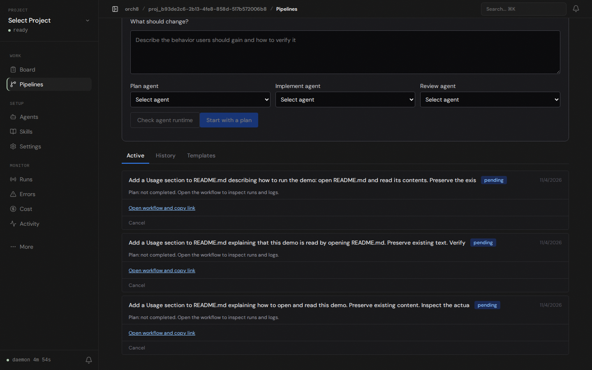

# Live workflow list, 2026-11-05

Captured with Playwright against the branch's running daemon and Vite dashboard at localhost:5173. The existing Factory demo project had three pending feature workflows. The list displayed the recorded Plan step as "not completed" and linked each workflow to its saved details. This is a real database read and browser render, not proof that an agent executed the plan.

This host still cannot run Codex's enabled workspace-write sandbox: bubblewrap fails to initialize the network namespace with `Failed RTM_NEWADDR: Operation not permitted`. No plan, implementation, independent agent review, test output, or feature PR was produced by these pending workflows. The feature-list change does not alter agent permissions or remove the runtime check.
