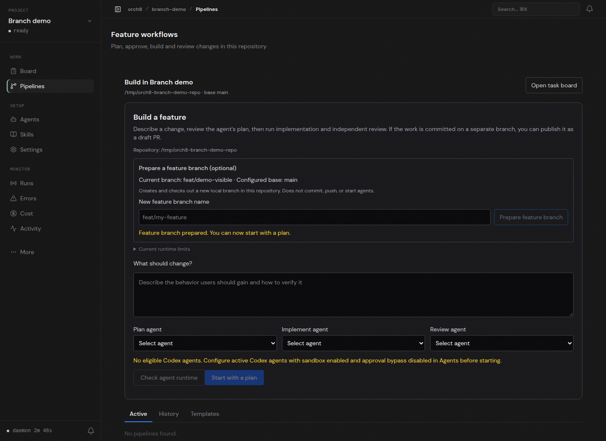

# Live branch preparation, 2026-11-04

The screenshot was captured from a running daemon and dashboard using a disposable Git repository at `/tmp/orch8-branch-demo-repo`. The browser opened the project feature intake, entered `feat/demo-visible`, and clicked Prepare feature branch. The dashboard displayed the new branch and success status; `git status --short --branch` independently returned `## feat/demo-visible`. No agent ran, no commit or PR was created in the demo repository.

Focused daemon route and Git-service tests, dashboard component tests, daemon/dashboard typechecks, dashboard production build, and changed-source lint ran successfully. Independent read-only review found no blockers in the initial diff. Live browser validation caught a slug-versus-ID error in the branch API call, which was fixed before capturing this screenshot.

The full plan, implementation, review and PR path remains unproven on this host. Codex's sandbox shell preflight is blocked by `bwrap: loopback: Failed RTM_NEWADDR: Operation not permitted`; no sandbox or permission bypass was used. A clean repository and a prepared local branch do not imply the agent runtime is ready.
