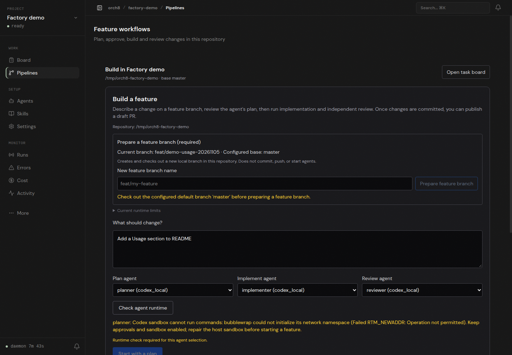

# Live feature-branch check

In the local `factory-demo` project, the dashboard prepared `feat/demo-usage-20261105` from `master`. Three separately configured Codex agents were selected for a README Usage request. The live runtime check reported that the Codex sandbox cannot initialize bubblewrap's network namespace (`Failed RTM_NEWADDR: Operation not permitted`), so **Start with a plan** remained disabled. The screenshot captures the actual dashboard response, not a fixture.

No real plan, implementation, independent product review, tests from an agent, or generated PR resulted from this run. The host needs the supported bubblewrap/AppArmor sandbox setup before a real feature run can proceed without bypassing protections. The diff's independent static review and dashboard checks are distinct from that missing execution proof.
