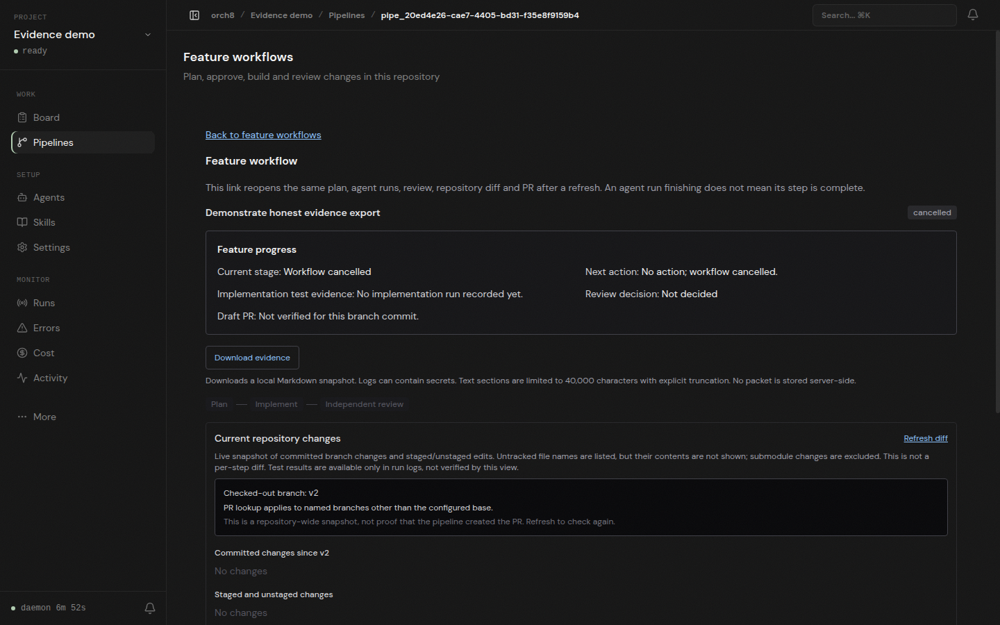
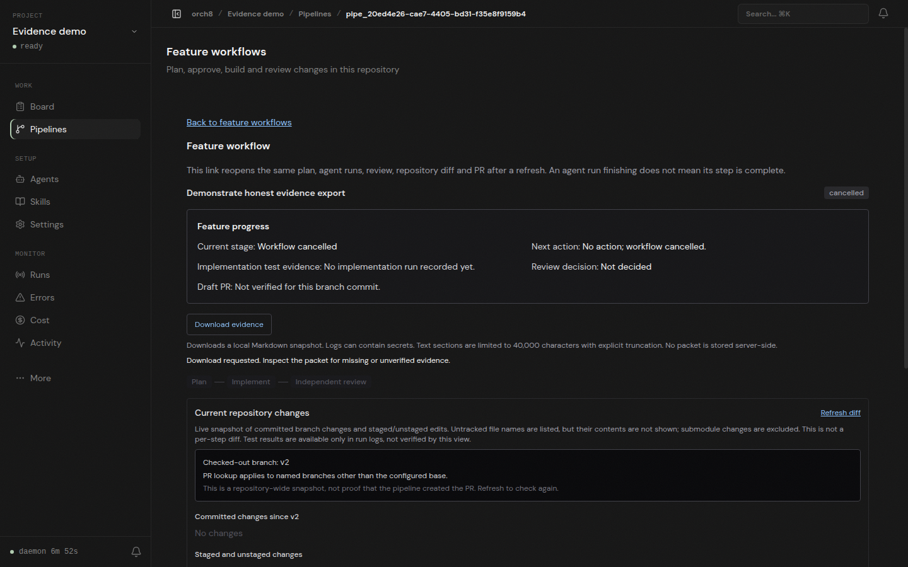

# Feature evidence download, browser check

An isolated daemon and dashboard opened a disposable Git repository's cancelled feature workflow. The real browser clicked **Download evidence** and downloaded the Markdown packet in this directory. The packet contains the workflow ID, current repository snapshot, and explicit missing/unverified labels for plan, agent run, review, tests, and PR. The page reported no JavaScript errors. The screenshots show the action before and after the click.

This demonstrates a browser download from live Orch8 endpoints, **not** an agent-executed plan, implementation, independent review, or PR. The demo pipeline was deliberately cancelled with no agents assigned and the disposable repository was on its base branch. The packet is a non-atomic current snapshot, not a signed audit record. It may contain secrets when real logs are present, so operators should review it before sharing.

The host's current supported Codex workspace-write runtime still cannot run commands. A direct `pwd` probe reported `bwrap: loopback: Failed RTM_NEWADDR: Operation not permitted`. We did not disable permissions or bypass the sandbox in the Orch8 workflow.

