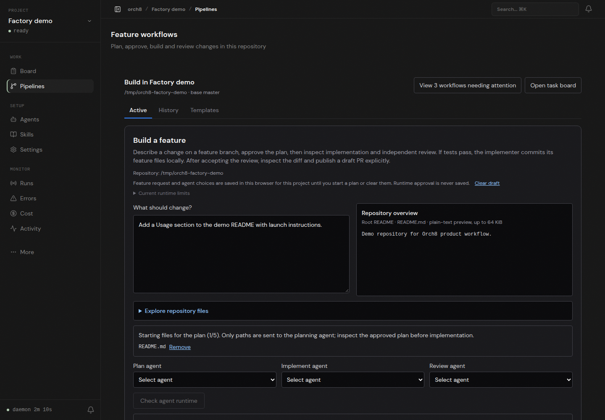

# Selected file context browser check

On the running Orch8 dashboard at `http://127.0.0.1:5173/projects/factory-demo/pipelines`, opened the local `/tmp/orch8-factory-demo` repository, entered a feature request, browsed its tracked `README.md`, and added that path as a starting file. Reloading restored both the request and selected path. The screenshot captures the actual running page after reload. No browser page errors occurred.

The focused dashboard test verifies that only the selected path, not file contents, enters the planning prompt after an explicit start, and checks removing/restoring the selection. The live Codex runtime check still failed with `bwrap: loopback: Failed RTM_NEWADDR: Operation not permitted`; Start with a plan remained disabled. No real planning, implementation, review, or PR publishing was performed through Orch8. Host sandbox repair requires an administrator; this run did not bypass approvals or permissions.
