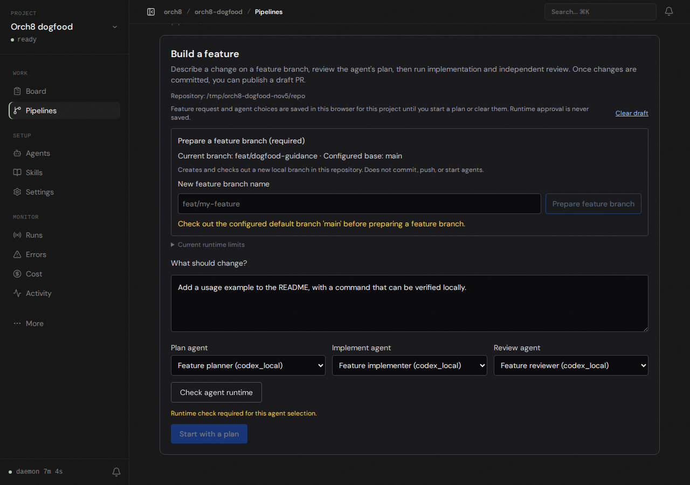

# Live feature-intake check

A disposable local Git repository was opened through the running Orch8 welcome flow at `http://127.0.0.1:5173`. The browser prepared a feature branch and configured three Codex agents with `workspace-write` and approval bypass disabled. The actual runtime check failed with `bubblewrap could not initialize its network namespace (Failed RTM_NEWADDR: Operation not permitted)`; no coding agent or pipeline ran.

In the same browser, a README feature request and the three selected agents survived a page reload. The screenshot shows the restored draft, a fresh-runtime-check requirement, and disabled Start action. The browser did not restore runtime clearance. The host lacks passwordless administrative access, so this run did not change its sandbox policy.

