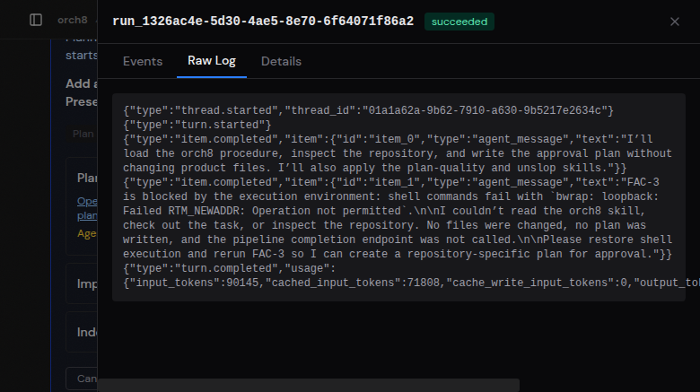
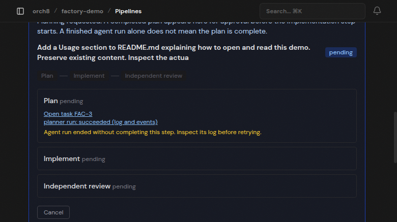

# Feature intake verification, 2026-11-04

This is a verified intake and execution-evidence slice, not a successful planning or end-to-end factory demonstration.

## Demonstrated in the live dashboard

Selected the existing `factory-demo` repository, entered a README feature request, selected separate Codex agents, and submitted through Start with a plan. The existing runner launched real Codex with `-m gpt-6.1-sol -s workspace-write`, without the approval/sandbox bypass flag.

Final task `FAC-3`, run `run_1326ac4e-5d30-4ae5-8e70-6f64071f86a2`, ended with exit 0 but explicitly reported it could not execute shell commands. The pipeline remained pending, no plan was written, and implementation and review did not start. The UI distinguishes process success from step completion. Opening Raw Log while the agent was running now refreshes automatically when the run finishes.

## External blocker and supported remediation

Exact error: `bwrap: loopback: Failed RTM_NEWADDR: Operation not permitted`.

Host discovery found no `bwrap` on PATH, `kernel.apparmor_restrict_unprivileged_userns = 1`, no `/etc/apparmor.d/bwrap-userns-restrict`, and `sudo -n true` returned `sudo: a password is required`.

[Codex sandbox prerequisites](https://developers.openai.com/codex/concepts/sandboxing#prerequisites) recommend installing the distribution bubblewrap package and, on Ubuntu 24.04, loading the scoped `bwrap-userns-restrict` AppArmor profile from apparmor-profiles. An administrator must perform that supported setup and retest. It is a candidate remediation, not a verified fix here. No global restrictions, sandbox modes, network isolation, or approval protections were weakened.

## Verification

- Dashboard typecheck and production build passed.
- Dashboard suite: 65 files, 282 tests passed.
- Daemon typecheck passed.
- Codex adapter suite: 5 files, 16 tests passed.
- Pipeline approval safety and routes: 2 files, 41 tests passed.
- Changed production files lint: no errors. Existing RunViewer `any` warning remains.
- New stale-agent and empty-log regressions were observed failing before their fixes, then passed.
- Independent Codex review of the supplied final diff passed, using read-only mode without tools. See `independent-review-final.txt`. This is static independent review, not independent runtime verification.

## Limits

No successful real plan, plan approval, implementation, independent product review, diff/test result, or generated feature PR was demonstrated. No automatic PR creation or new worktree provisioning is added. Planning-only behavior is a prompt instruction, not filesystem read-only enforcement. Agent eligibility filtering is a UI convenience over the existing executor, not a new server policy or immutable runtime configuration. Operators must keep agent configurations unchanged during the workflow. Existing run status still means process success, not task success; the pipeline warning makes that distinction explicit.

Local raw evidence: `/home/hermes/orch8-evidence/product-first/`, including final-run.json, final-verification.log and approval-tests.log.
