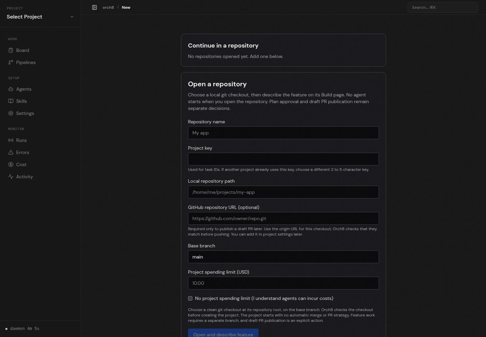
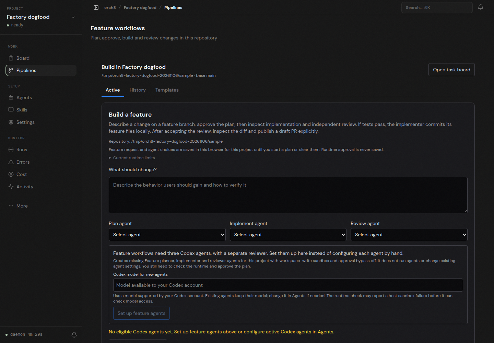

# First-run repository entry, live browser check

In an isolated Orch8 daemon and dashboard, opening `/` with no projects reached `/projects/new` rather than the legacy general-purpose wizard. The browser entered a clean local Git checkout (`main`) and a $1 project limit, submitted the repository form, and reached the project's Build page and feature request field. No agents were configured or run, and no plan, tests, review, or PR were produced in this check.

The actual Codex `workspace-write` shell probe on this host failed before `pwd` with `bwrap: loopback: Failed RTM_NEWADDR: Operation not permitted`. The installed Claude CLI also returned an expired OAuth token. Real agent execution remains blocked until a supported sandbox is repaired or an authenticated supported runtime is available. No approval or sandbox bypass was enabled.
