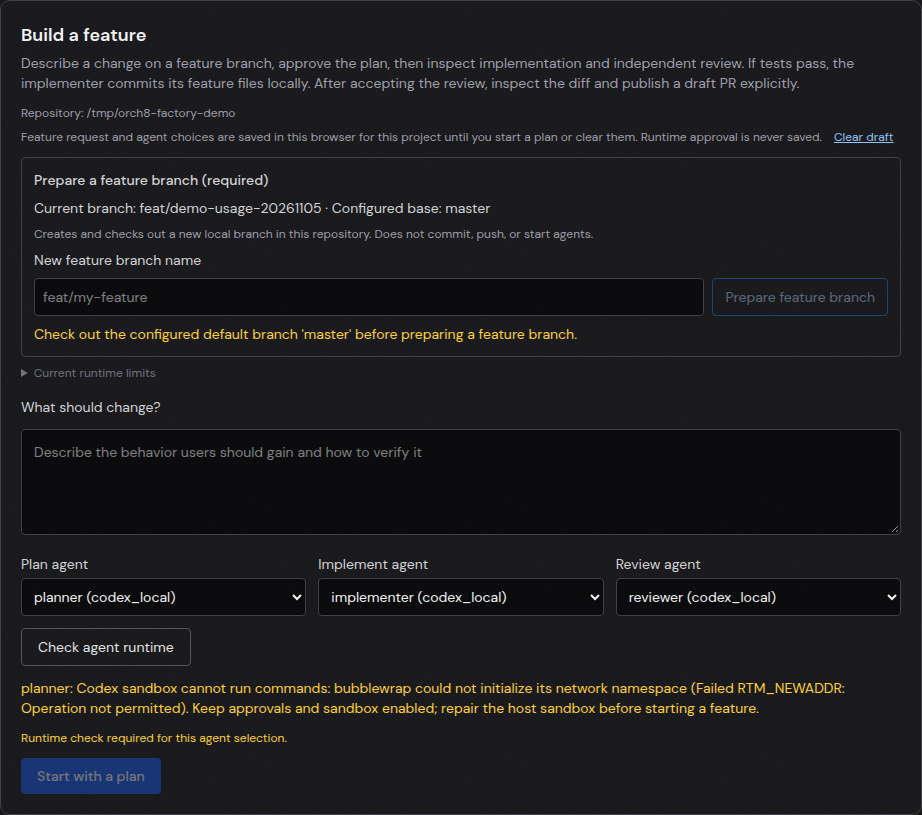

# Implementation to draft PR

The feature workflow now asks the implementer to run tests, record bounded evidence, inspect the staged diff and commit only intended feature files locally when tests pass. A separate reviewer is instructed to inspect the actual committed diff, uncommitted changes and run log without editing or committing. Publishing a draft PR remains a separate human-confirmed action. If a completed workflow has no feature commit or has dirty files, the detail view names those blockers.

This is an instruction and UI change, not proof that an agent completed a feature. The live dashboard loaded this version against the existing `factory-demo` repository. Selecting its three Codex agents and checking runtime returned `bubblewrap could not initialize its network namespace (Failed RTM_NEWADDR: Operation not permitted)`. Start remained disabled. No plan, implementation, review, commit or PR was created by this check.

