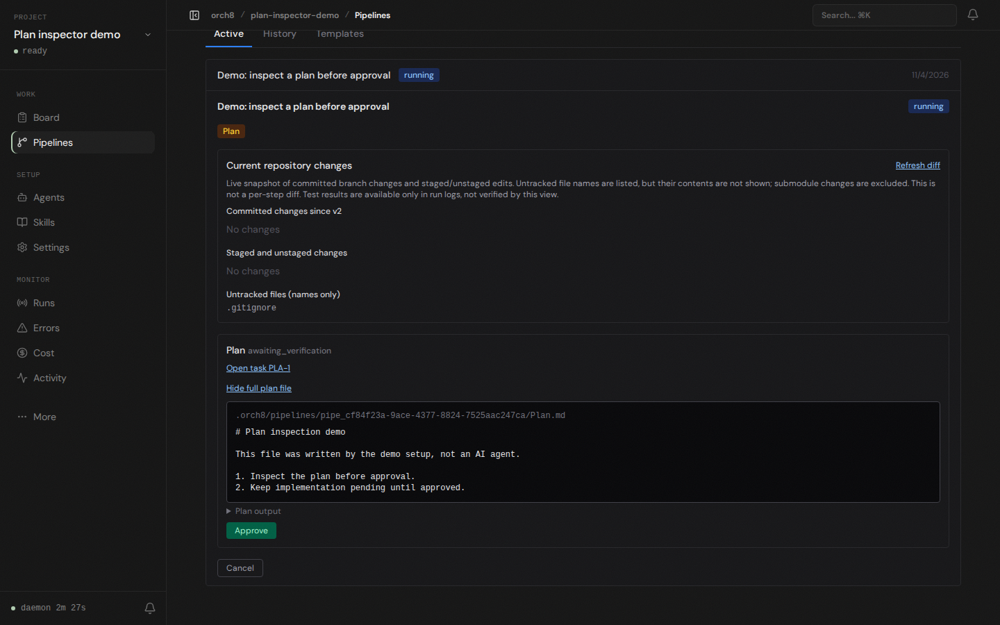

# Plan inspection demo

The dashboard now fetches the recorded step file from the project's pipeline directory and shows it next to the approval action. The API enforces the pipeline's project scope, constrains the file to the pipeline artifact directory, rejects symlink escapes, and caps the response size. The view refreshes across step attempts.

The screenshot below came from a running isolated daemon and dashboard using a temporary Git repository. The file and step completion were created **manually by the demo setup**, not by an AI agent. The browser opened the pipeline and fetched the file via the live API; the approval button was visible but not clicked.

Runtime evidence: `GET /api/pipelines/pipe_cf84f23a-9ace-4377-8824-7525aac247ca/steps/pstep_69c86332-c4a8-431d-b5ed-678eb9d5da3e/output` returned the file content. Browser automation confirmed the content and approval action were visible together. The earlier real Codex run remains blocked by `bwrap: loopback: Failed RTM_NEWADDR: Operation not permitted`; this manual demo does not prove end-to-end agent execution or PR creation.
