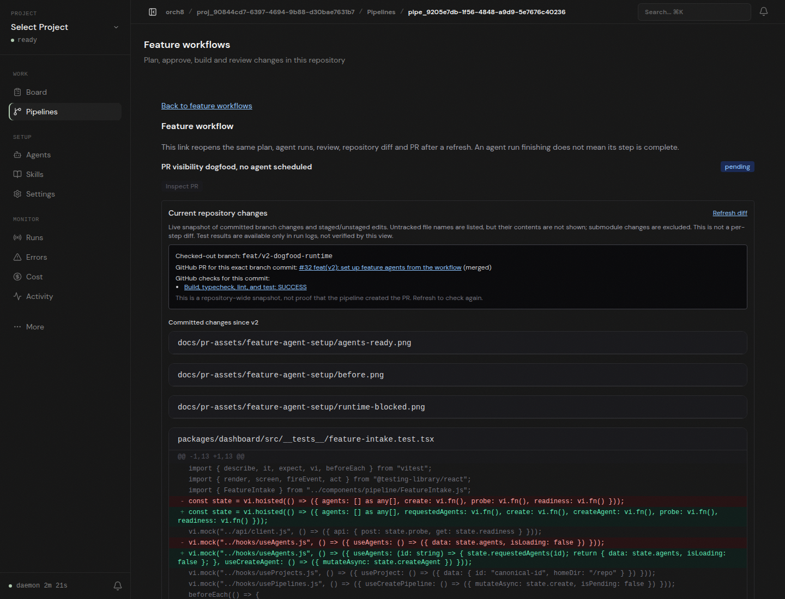

# Live PR check visibility, 2026-11-05

The screenshot shows the running Orch8 dashboard against an isolated local daemon. The project points to a separate worktree at commit `73c367bf2068f462c31492d6aa40b28fccce7e84` on `feat/v2-dogfood-runtime`. The daemon matched that exact commit and branch to merged [PR #32](https://github.com/orch8/orch8/pull/32), then displayed GitHub's actual `Build, typecheck, lint, and test: SUCCESS` check with its job link. The API returned the same status. The dashboard also shows the committed diff and distinguishes the repository snapshot from pipeline-created work.

The `PR visibility dogfood, no agent scheduled` pipeline was created only to inspect the live repository/PR panel. It has no assigned agent. This is **not** evidence of plan, implementation, review, or PR publication by that pipeline. The host still cannot run the configured Codex workspace-write sandbox because `bwrap: loopback: Failed RTM_NEWADDR: Operation not permitted`. No approvals or sandbox restrictions were bypassed.

The check display reflects GitHub's latest response when Refresh diff is clicked; an absent rollup is labeled `No checks reported`, not passing. This panel does not certify test results or merge readiness.

