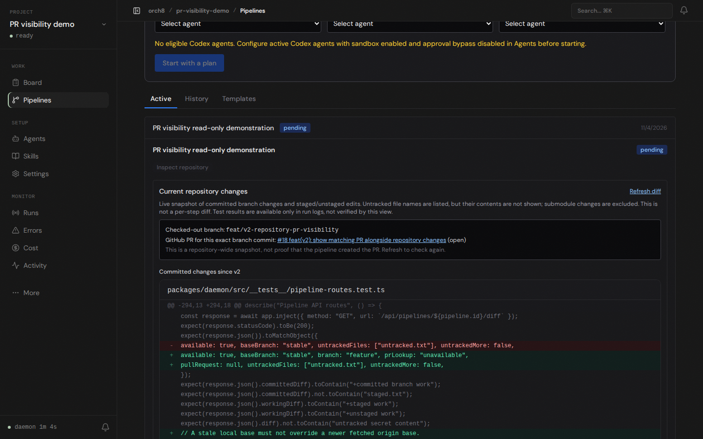

# PR inspection demo

This screenshot is from the live dashboard and daemon, with a local demo project pointed at this task branch. The demo pipeline was created without an agent to exercise the repository inspection panel; it did not create the PR. The daemon's read-only `gh pr list` lookup returned PR #18 because the local HEAD commit matched GitHub's head commit and the base was `v2`. The panel showed only this task branch's committed files after preferring the fetched `origin/v2` ref over a stale local `v2` branch.

This is not an end-to-end agent workflow demonstration. Real planning and implementation remain blocked on this host by the Codex `workspace-write` sandbox failing inside bubblewrap (`bwrap: loopback: Failed RTM_NEWADDR: Operation not permitted`). No permission or sandbox bypass was introduced.
