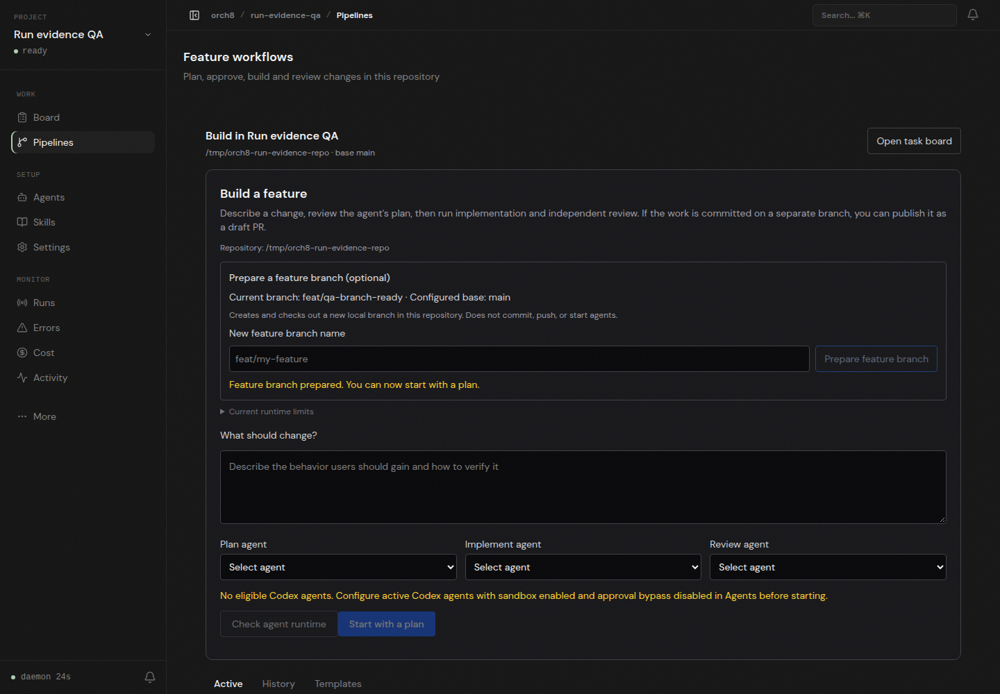

# Branch preparation after project creation

An isolated Orch8 daemon and dashboard opened a newly provisioned Git repository. Project creation left only Orch8's generated `.gitignore` untracked, which previously disabled branch preparation. In a real Chromium session, the feature page displayed the pending-ignore note; clicking Prepare feature branch changed the checked-out branch to `feat/qa-branch-ready`. Independent `git status --short --branch` returned `## feat/qa-branch-ready` and `?? .gitignore`. No file was committed, no agent ran, and no PR was published from the demo repository.

The demonstration does not prove plan, implementation, review, tests or PR publication. On this host, Codex's workspace-write sandbox still fails `bwrap: loopback: Failed RTM_NEWADDR: Operation not permitted`; no sandbox or approval bypass was used.
