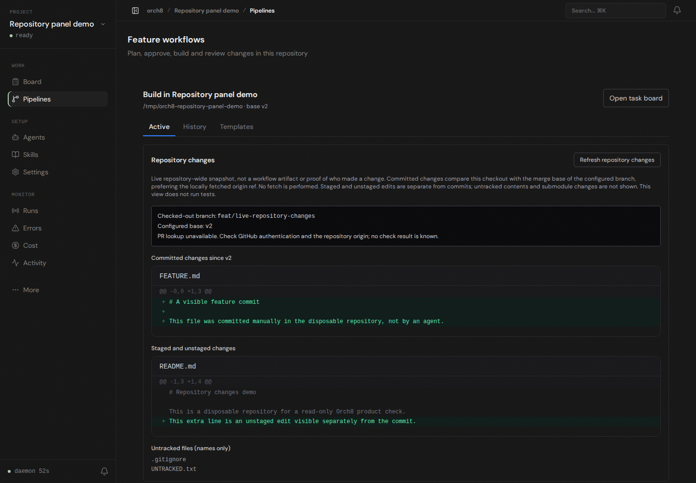

# Live Build-page repository inspection

A fresh, isolated Orch8 daemon opened a disposable local Git repository with no workflows. The checkout was on `feat/live-repository-changes` against `v2`. A manually committed `FEATURE.md`, an unstaged `README.md` edit, and an untracked `UNTRACKED.txt` appeared in separate sections on the Build page. The browser refresh control worked and Playwright reported no page errors. No agent ran; these are manual repository changes, not agent execution evidence.

The disposable repository had no GitHub origin, so the UI correctly reported PR lookup unavailable. The existing Codex sandbox on this host still fails with `bwrap: loopback: Failed RTM_NEWADDR: Operation not permitted`; the Claude CLI's OAuth access token is expired. The full plan-to-PR agent journey was not demonstrated.
