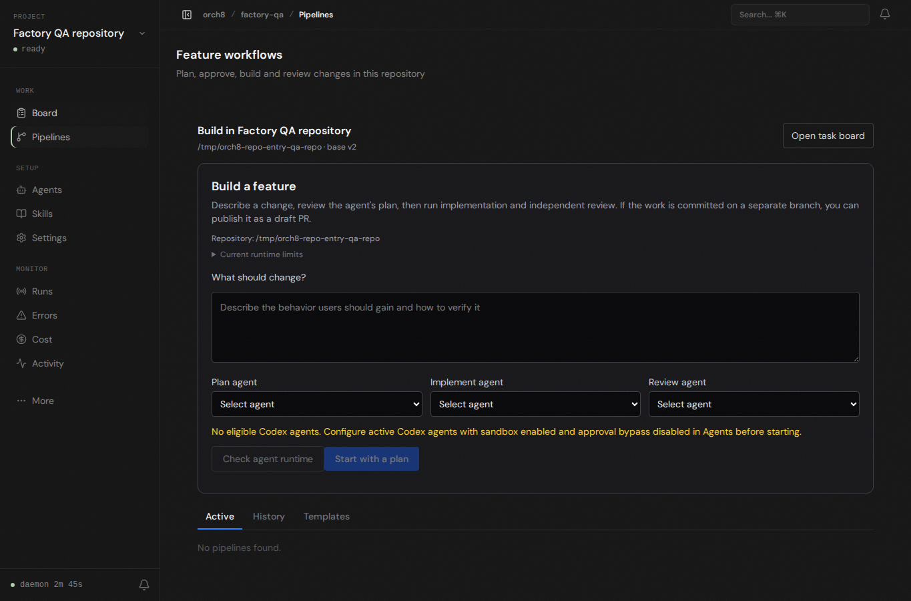

# Repository feature entry, 2026-11-04

The project root now opens the feature workflow for the selected repository. The repository name, path and configured base branch appear above the request form. The task board remains one click away and links back to feature intake.

Browser check used the running daemon and dashboard from this branch, an isolated Orch8 home, and a temporary Git repository on `v2`. Playwright opened `/projects/factory-qa`, observed the redirect to `/pipelines`, checked the repository path and base branch, opened the task board and returned to feature intake. The screenshot is from that live page, not a mocked component.

This check did **not** execute an agent or demonstrate plan, implementation, review or PR publication. The host's Codex sandbox still fails to initialize a network namespace (`bwrap: loopback: Failed RTM_NEWADDR: Operation not permitted`); the UI shows no eligible agents in this isolated runtime. No approval or sandbox guard was bypassed.
