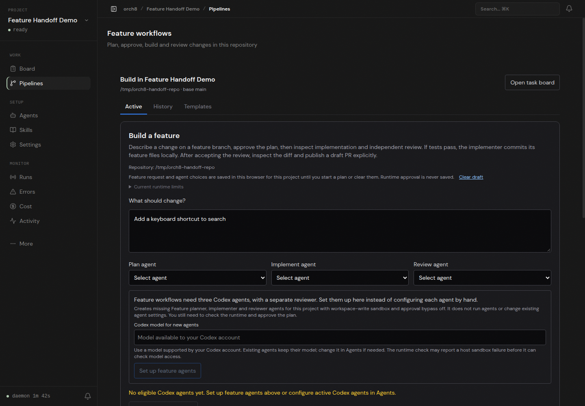

# Repository to feature handoff

Using an isolated Orch8 daemon and live Vite dashboard, I opened a clean disposable local Git repository on `main`, entered `Add a keyboard shortcut to search` during repository setup, and clicked **Open and describe feature**. The browser navigated to the new repository's Build page with that exact request in **What should change?**. **Start with a plan** remained disabled; no agents were started. The browser reported no page errors.

The host's Codex `workspace-write` runtime still fails before shell execution with `bwrap: loopback: Failed RTM_NEWADDR: Operation not permitted`. This check does not demonstrate a plan, implementation, independent review, tests, or a PR generated by Orch8. The screenshot is live repository setup and feature intake only.
