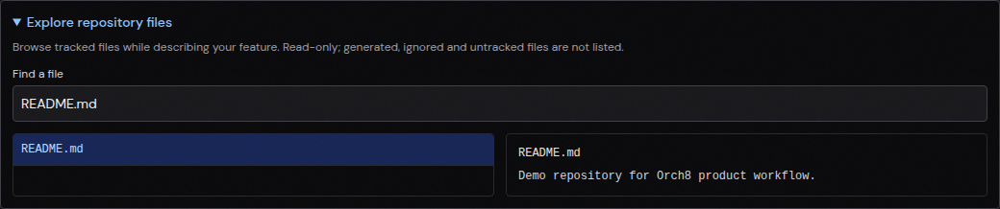

# Repository file explorer browser check

On a running Orch8 daemon and dashboard at `http://localhost:5173/projects/factory-demo/pipelines`, opened the Build intake for the local `/tmp/orch8-factory-demo` Git checkout. Searched tracked paths for `README.md`, selected the file and read its actual contents in the preview. Playwright reported no page errors. The screenshot captures the selected path and preview.

The repository-file API test covers tracked versus untracked paths, a symlink outside the repository, cross-project denial, and search. This run did not execute a coding agent, plan approval, review, or PR publication through Orch8. The host Codex workspace-write sandbox remains blocked by bubblewrap namespace setup; no approval or sandbox bypass was used.
