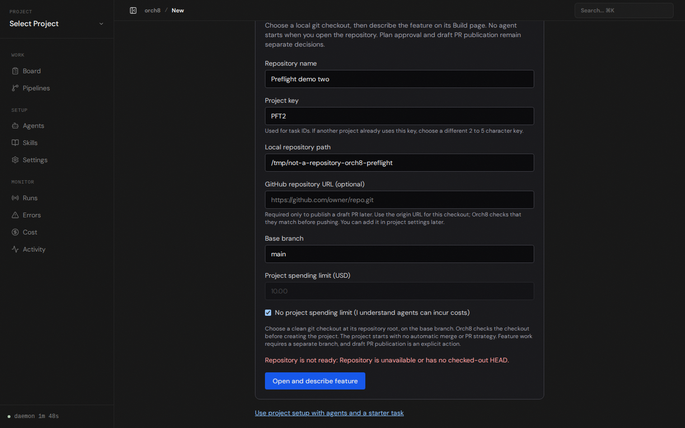
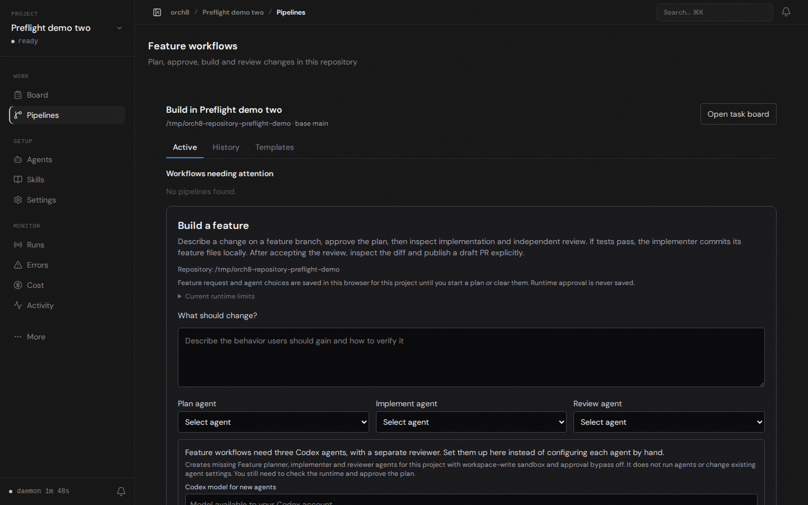

# Repository preflight browser check

In an isolated local daemon/database, opening `/projects/new` with a nonexistent path showed a repository error and kept the form. No project was created for that request. Changing the path to a clean local Git checkout on `main` opened its feature intake. Chromium reported no page errors. The browser check used a temporary demo repository; it did not run an agent, approve a plan, or publish a PR.

The quick repository form now calls the read-only preflight before project creation. The separate advanced project wizard is unchanged and supports broader project setup. The current host still cannot run the selected Codex workspace-write runtime because bubblewrap fails to initialize its network namespace. A real plan, implementation, and review remain unverified.
