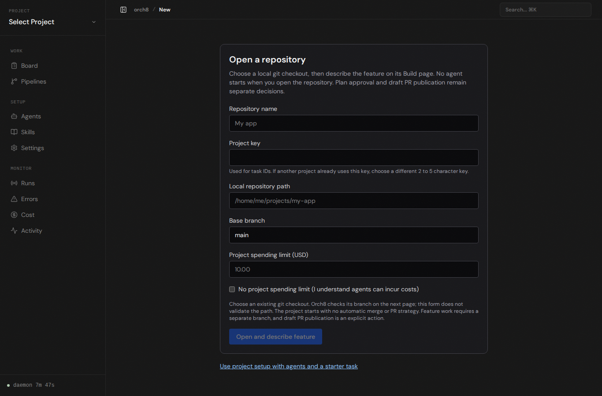
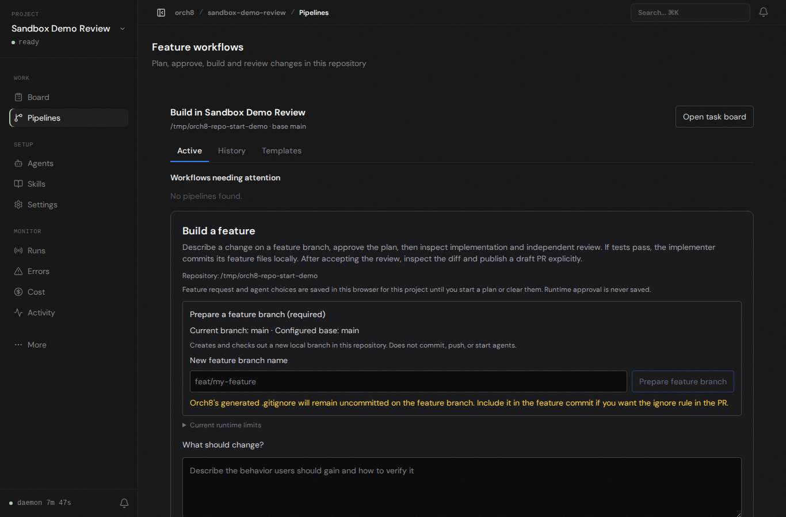

# Repository to feature intake

On an isolated local daemon and database, the new repository form opened `/tmp/orch8-repo-start-demo` with project key `SDB2`, base branch `main`, a $10 project spending limit, and no automatic merge or PR strategy. The browser navigated to `/projects/sandbox-demo-review/pipelines` and showed the selected repository's Build a feature form. Start with a plan remained disabled until a branch and eligible runtime are provided. Chromium reported no page errors.

This is live browser evidence for onboarding, not agent execution. The host's Codex workspace-write sandbox fails before `pwd` with `bwrap: loopback: Failed RTM_NEWADDR: Operation not permitted`; no plan, implementation, independent review, or product-generated PR was executed. No sandbox, approval, or budget setting was bypassed.
