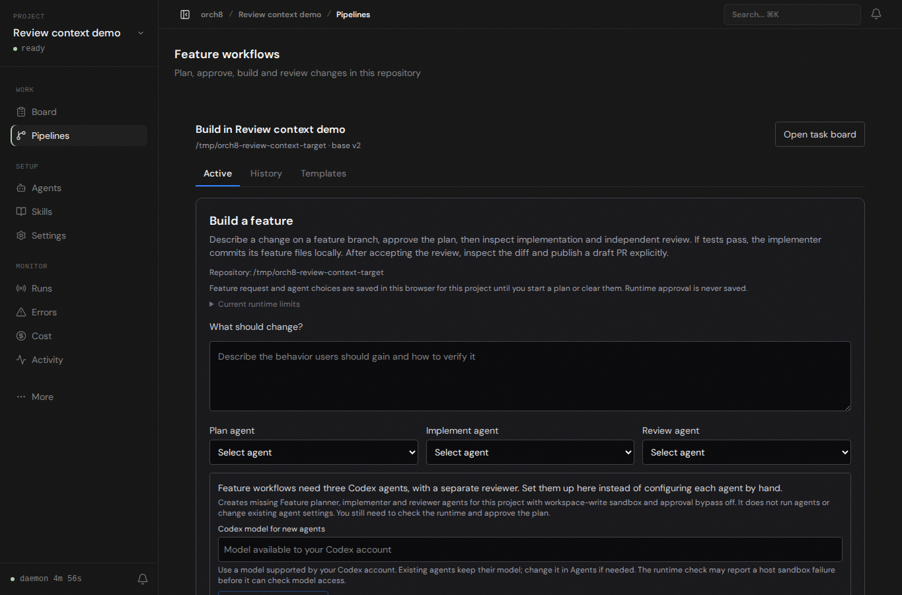

# Build-first browser check

A fresh isolated daemon opened a disposable local Git checkout through the real dashboard. The Build page now places the feature request and agent selection above the repository-wide diff. At 1365 × 900, the feature heading starts at y=320 and the request input is visible in the first viewport; Chromium reported no page errors. The screenshot is from this live page.

The review decision's adjacent committed/uncommitted diff and run-log link were checked in component tests and the dashboard production build, not in a live agent workflow. The host's Codex workspace-write sandbox still cannot initialize bubblewrap (`bwrap: loopback: Failed RTM_NEWADDR: Operation not permitted`). No real plan, implementation, independent review, test run, or PR publication was produced here. This screenshot is not proof of agent execution.
