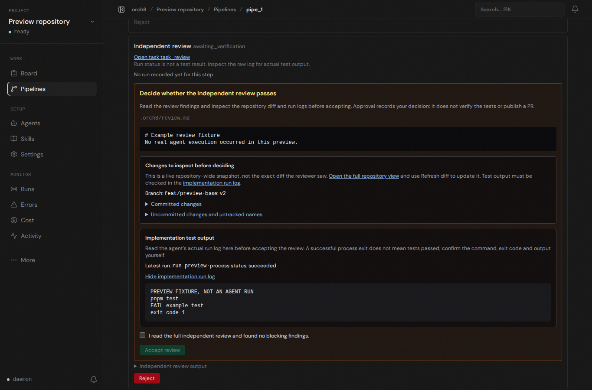

# Review decision, browser preview

At the independent-review decision, the dashboard now opens the latest implementation run's raw log next to the review file and repository diff. It labels the run status as a process status, not a test verdict. If no run or log is stored, the page says so rather than suggesting tests passed. The same raw log remains available in the step details.

This screenshot exercises the built dashboard UI with intercepted API fixtures. The fixture explicitly says `PREVIEW FIXTURE, NOT AN AGENT RUN` and contains a failing example test. It is **not** evidence of real agent execution or a successful review. The host's actual Codex workspace-write preflight still fails with `bwrap: loopback: Failed RTM_NEWADDR: Operation not permitted`; without administrator repair, the plan-to-PR path cannot run here. No sandbox or approval settings were bypassed.
