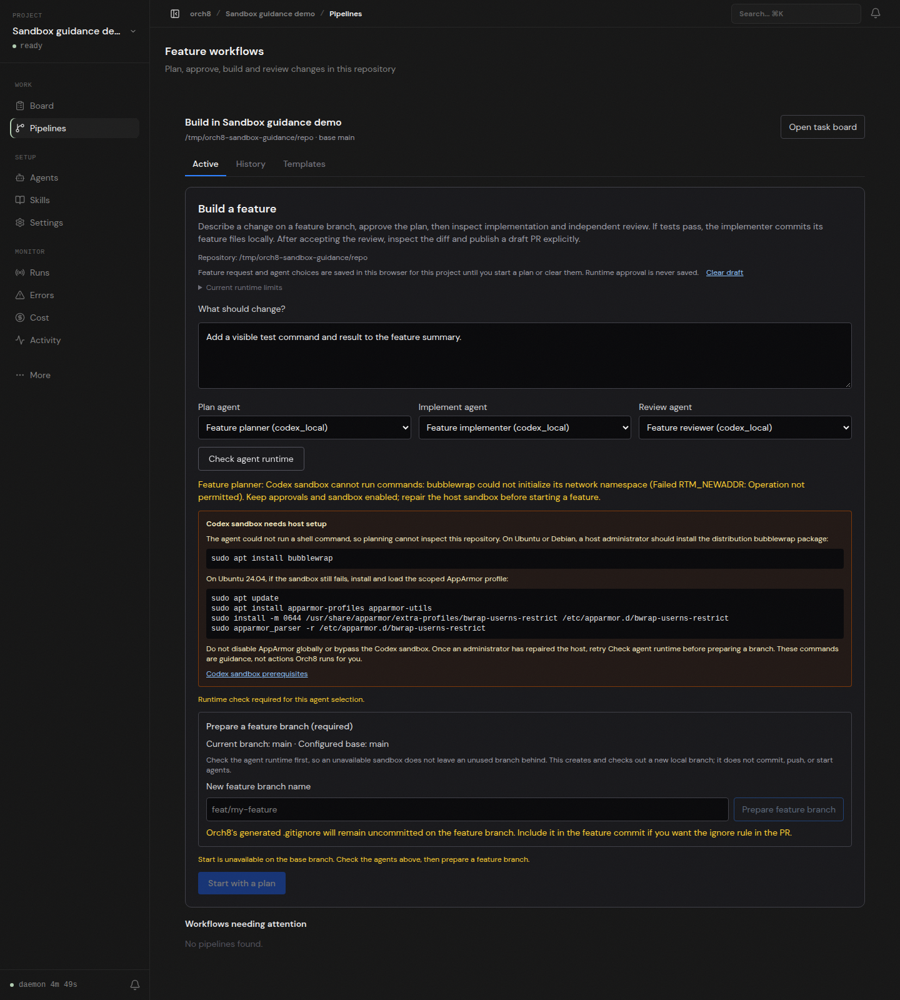

# Blocked sandbox, live browser check

An isolated Orch8 daemon and Vite dashboard opened a disposable local Git repository. The browser created three feature agents using workspace-write with approval bypass off, entered a feature request, selected separate implementer and reviewer agents, and clicked **Check agent runtime**. The real daemon preflight returned `Failed RTM_NEWADDR: Operation not permitted`; the page showed the official scoped host repair steps and kept both **Prepare feature branch** and **Start with a plan** disabled. The browser reported no JavaScript errors. No feature agent, plan, implementation, test, review, or PR ran in this check.

The Ubuntu 24.04 instructions match the [Codex sandbox prerequisites](https://developers.openai.com/codex/concepts/sandboxing#prerequisites). This host lacks passwordless sudo, so the required administrator setup was not applied. Neither AppArmor nor Orch8's approval and sandbox settings were weakened.
