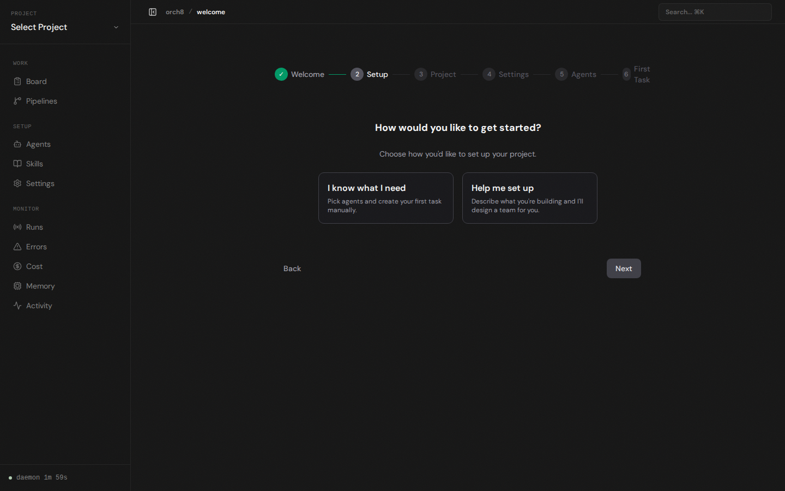
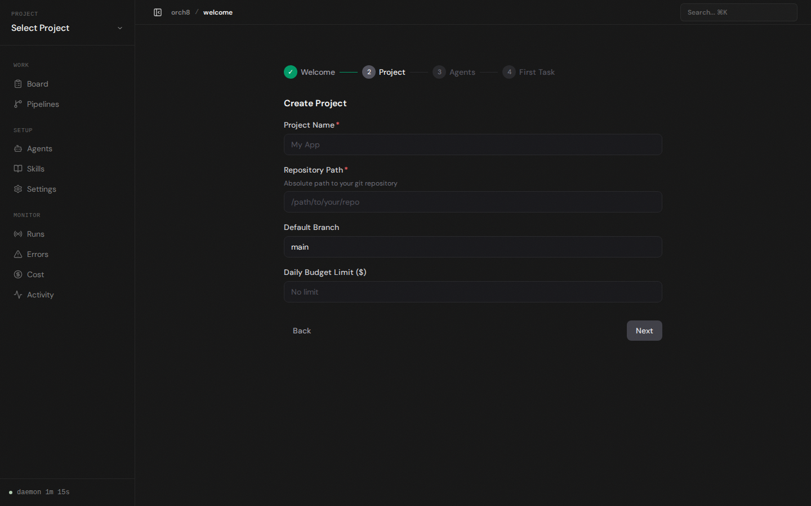
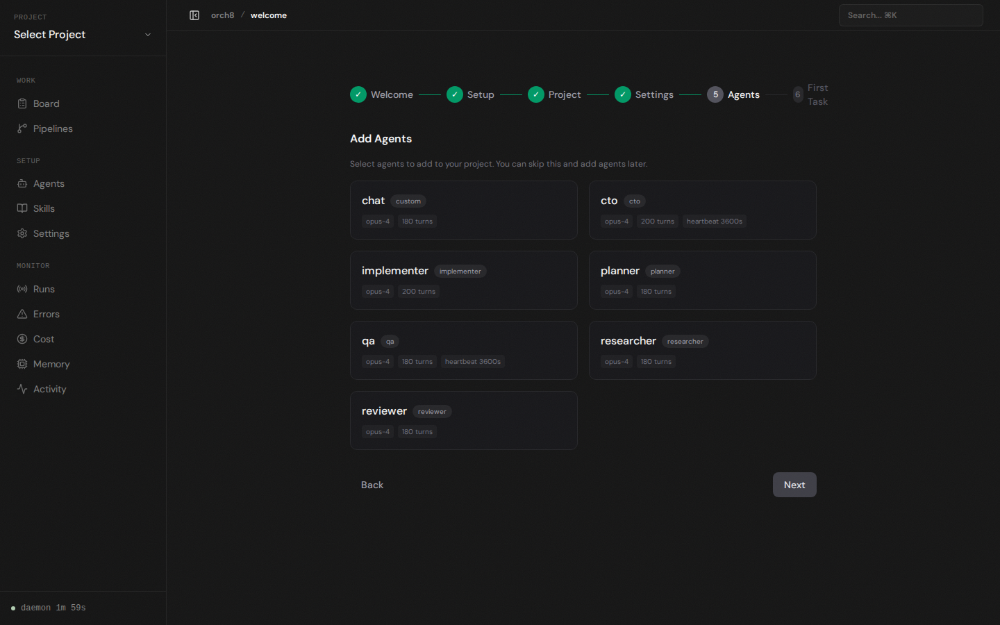
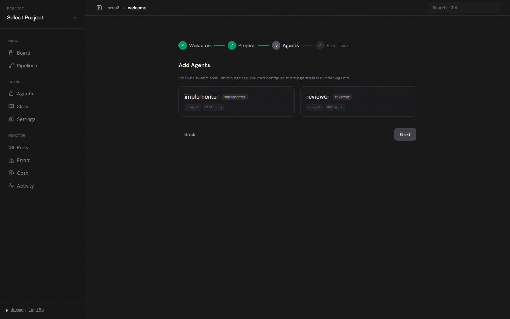
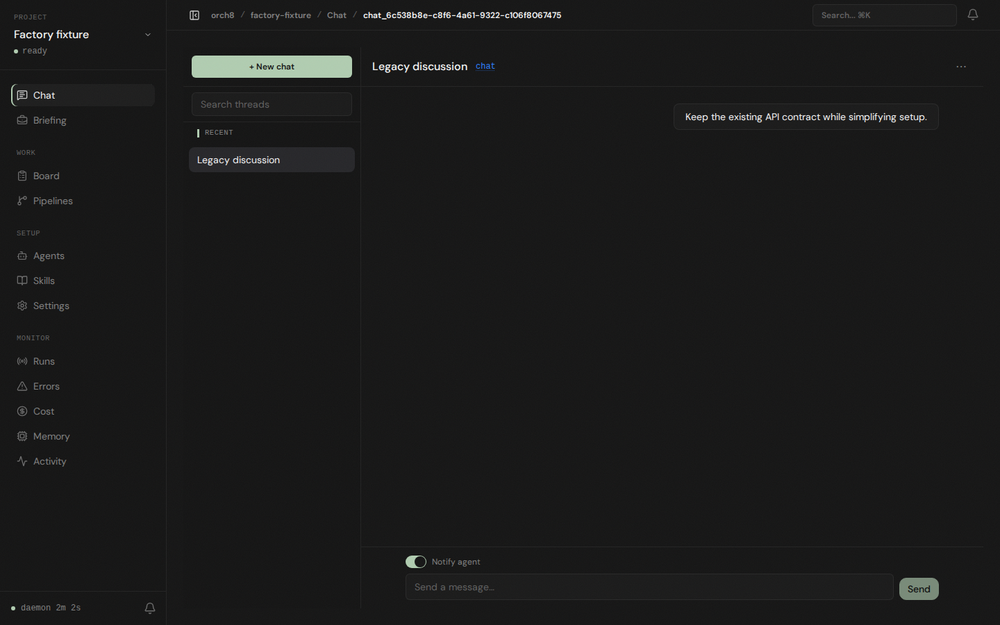
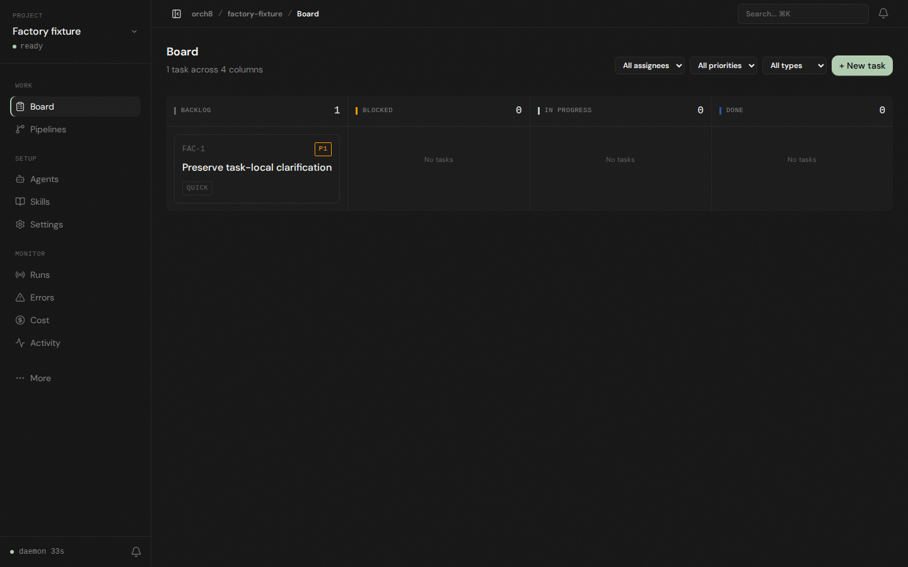
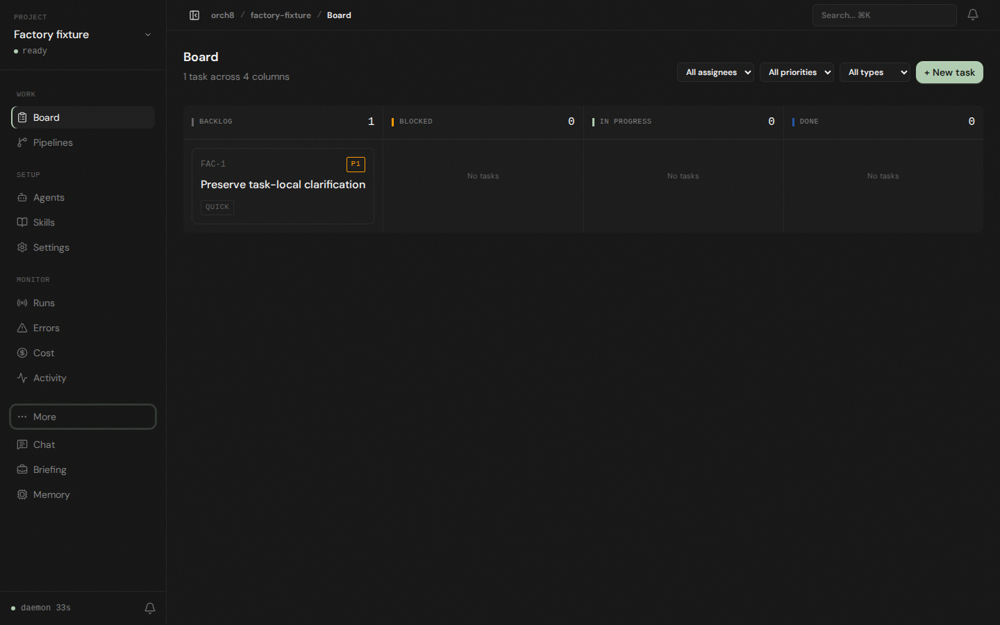
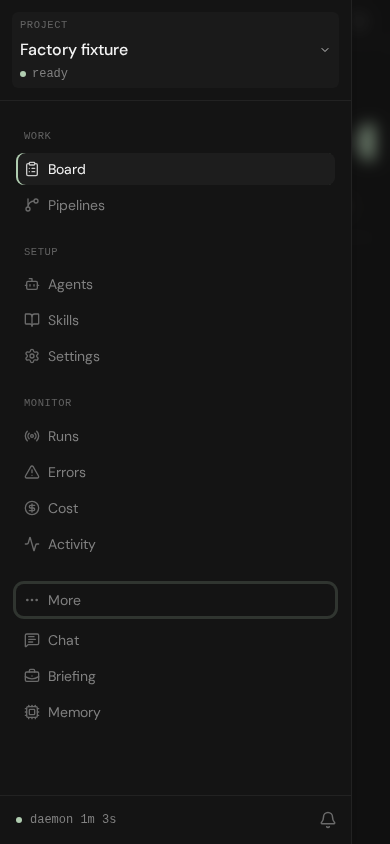

# Factory-defaults evidence

The committed selection is enumerated in `manifest.json`, with original and packaged SHA-256 hashes. Logs, JSON and reproduction scripts are gzip-compressed without changing their original bytes. Other ignored files in the local evidence directory are not part of this PR.

## Final results

- Shared 180, CLI 4, daemon 773 and dashboard 278 assertions passed. Total 1235 in 169 test files, with no failed or skipped assertions.
- Uncached serial typecheck and build passed. Lint passed with 66 warnings and zero errors. Build emitted a nonfatal chunk-size warning.
- All source files matched the final gate manifest and independent quality-review hashes immediately before packaging. Baseline is `87267e7df8d9c28568c3ed880899221c850018b6`. The source manifests include the scratch fixture, which is preserved only as compressed reproduction evidence under `browser/`, not as executable application code.
- Independent specification and quality reviews found no production blocker. Final gates resolve the specification review's stale dashboard/typecheck gap. The quality review's later keyboard and mobile verification resolves its browser acceptance gap.

Read `final-gates.md`, `quality-review.md` and `spec-review.md` together. They retain the review chronology rather than rewriting earlier findings.

## Historical failures and limitations

`gates/daemon.json.gz` and `gates/test-daemon.log.gz` preserve the failed ENOSPC attempt, which returned exit zero despite failed setup. This is not a passing test run. The complete unchanged-source retry used tmpfs and passed; see `daemon-tmpfs.json.gz`, `test-daemon-tmpfs.log.gz` and `daemon-retry-gate.json.gz`.

The baseline browser record includes an empty early after-entry capture. It is not successful Board evidence. Use the later `desktop-board.png` and `browser/verification.json.gz`. The first quality browser script stopped on a screenshot error; separate browser-extra and verification scripts completed the remaining checks. Reviews explain these limits.

Existing shared layout issues remain: cramped collapsed navigation, mobile Board toolbar clipping and a narrow mobile Memory detail pane. The existing partial-setup retry limitation also remains. No claim is made about live paid-agent execution or idle legacy projects with configured heartbeats.

## Before and after

Baseline setup choice:

Revised project step:

Baseline onboarding catalog:

Optional task-driven onboarding choices:

Baseline project entry into Chat:

Final project entry into Board:

More disclosure and mobile navigation:

Additional selected images cover collapsed keyboard navigation, preserved legacy Chat, the normal full agent catalog and task-local comment persistence. Disposable fixture data is not live user data.
