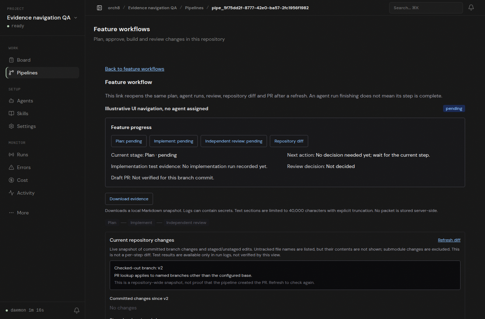

# Workflow evidence navigation browser check

The screenshot was captured from a running Orch8 daemon and Vite dashboard at `http://127.0.0.1:5173` using a disposable local Git repository and isolated database. The browser loaded a real API-created workflow named "Illustrative UI navigation, no agent assigned". All three steps remain pending. The browser found four navigation links and matching targets for plan, implementation, independent review and repository diff, clicked the review link, and observed the URL hash change. No page errors were reported.

This is a UI navigation check, not proof of agent execution. No agent was assigned or run in this example. The actual Codex workspace-write runtime on this host still fails its shell call with `bwrap: loopback: Failed RTM_NEWADDR: Operation not permitted`; an administrator must restore the supported sandbox environment before the real plan, implementation, independent review, tests and draft PR can be demonstrated. Neither bypass flags nor approval settings were changed.
